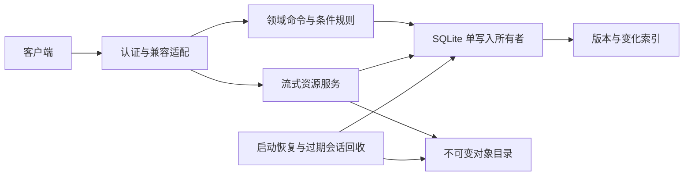

# 架构与目录

状态：基本服务端的记录、快照/变化、租约与资源服务已实现；上位规格：[spac.md](../../spac.md)。

## 技术取舍

一个 Rust crate，Tokio + Axum 负责 HTTP；SQLite WAL 保存记录、历史版本和恢复证据；文件目录保存不可变资源。首版不引入分布式数据库，不用文件名/mtime 充当内容身份。

选择 SQLite 的依据是首版单进程和单账户规模，而不是认定它天然比 FoundationDB 快。保留存储边界，出现经实测的吞吐、可用性或多实例需求时再评估后端。



## 计划目录

```text
syncserver/
  AGENTS.md / Agent.md / spac.md / README.md / LICENSE
  docs/design/                 规范、兼容范围、状态机、验证和实施计划
  docs/adr/                    架构决策记录
  src/
    main.rs                    配置校验、恢复、启动、关闭
    lib.rs                     公共模块边界，便于集成测试
    config.rs                  配置与密钥引用
    api/                       CloudKit 风格适配、错误和认证
    domain/                    类型、条件、状态转换；不依赖 Axum/SQLite
    store/                     迁移、事务、版本、索引、签名游标的数据边界
    assets/                    上传、摘要、文件发布、下载
    jobs/                      恢复和有界后台任务
  tests/                       协议、成本、并发和进程重启测试
  deploy/                      后续 systemd、容器和反向代理配置
```

上述 Rust/Cargo 与部署文件现已建立，实际边界见[基本实现](v0.1-server.md)。

## 模块与所有权

| 模块 | 拥有 | 不拥有 |
|---|---|---|
| api | JSON/URL 适配、请求上限、认证、错误映射 | SQL、哈希、客户端业务策略 |
| domain | ID、revision、digest、条件、状态转换 | HTTP、文件系统、数据库连接 |
| store | 数据库写入所有权、迁移、版本分配、原子变化、快照水位 | 上传正文、GTK、网络 |
| assets | 流式 I/O、摘要、暂存和不可变发布 | 自行修改记录或推进游标 |
| jobs | 启动恢复、会话回收、优雅关闭 | 在首版偷偷裁剪历史或删除已发布对象 |

SQLite 写入由一个有界执行器串行持有连接；在专用阻塞线程上运行，API 使用异步命令/响应。读取可使用独立的有界只读连接。记录与变化写入同一事务，所有事务不等待网络或大文件 I/O。

## 请求路径

元数据：认证 → 检查范围和能力 → 领域命令 → 数据库执行器 → 兼容响应。

上传：获取会话 → 有界流式写入并计算摘要 → 资源发布协议 → 返回可信资源描述。

增量：验证 token → 捕获或复用固定水位 → 索引读取 → 响应和下一 token。不会读取资源正文。

## 并发边界

- 一个命名空间内全局提交序号由 SQLite 事务分配，只有提交成功才可见。
- 资源不可变；并发同摘要发布通过文件和数据库唯一约束协调。
- 读请求不长期持有事务等待客户端。跨请求快照通过保留历史版本和固定水位表达。
- token 签名密钥和数据库 generation 跨重启稳定；不同类型 query/lookup 共用独立 snapshotToken/H。
- 初始 zone 与 namespace 配置固定，重启不允许静默变更范围；照片一对一图与共享资产规则遵守冻结契约。
- 关闭顺序为停止接收新操作、结算已发出的发布与事务、保存恢复证据、释放连接。

## 媒体分层

记录中明确 original/thumbnail 角色。两资源稳定入库后通过照片绑定事务发布。服务端不将原图回退为缩略图，提供独立描述和下载。

客户端取得元数据后下载并验证原图与缩略图；每张照片成对稳定落盘、完成缓存映射后再入库。复用当前本地媒体模型和宫格/详情加载，不新增未下载原图项目或按访问触发网络下载。见[完整媒体同步](media-sync.md)。

## 客户端边界

PhotoViewer 保留自己的三方规划、上传范围、删除抑制和本地 staging。客户端接入后须将远端变化、待处理路径与游标一起持久化；该客户端事务不会被服务端的成功响应自动替代。

## 新上行协调职责（服务端已实现，客户端待 C1）

api 统一租约请求头/错误/原生控制路径，domain 定义过期/fence/进度/阶段，store 在唯一写入线程内事务校验持有者与最终写入；jobs 管理失效取消与控制请求公平性，assets 绑定长流和发布意图代次。只读路径仍独立开放，不获取设备上行锁。

客户端 dirty 是本地既有 DB 字段，任务视图从该字段派生；仅有效成功确认回调更新对应版本。配对发布台账和下载待办不是另一份 dirty 状态。具体机制见[协调契约](../contracts/upload-coordination.md)，实施顺序见[开发任务](next-development-tasks.md)。
